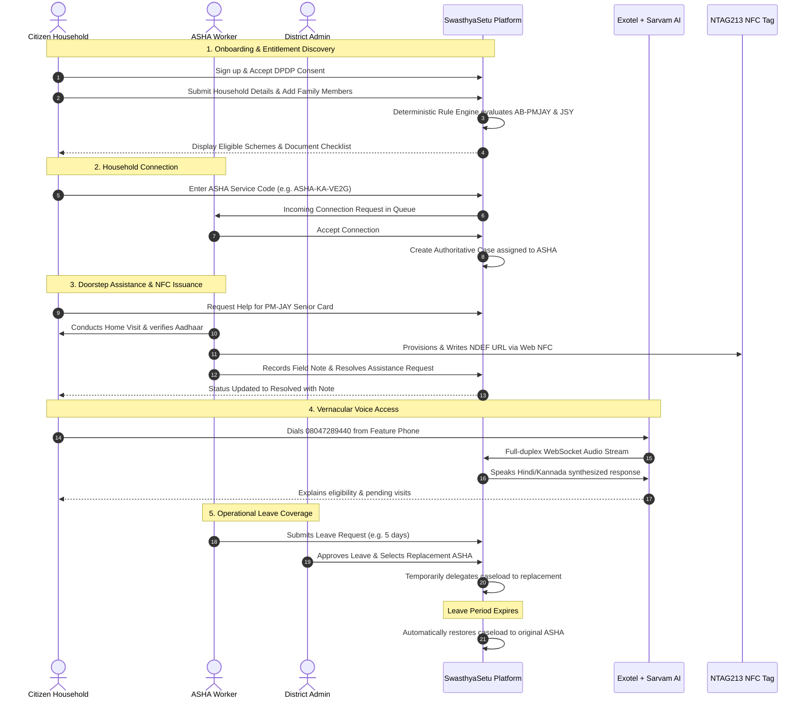
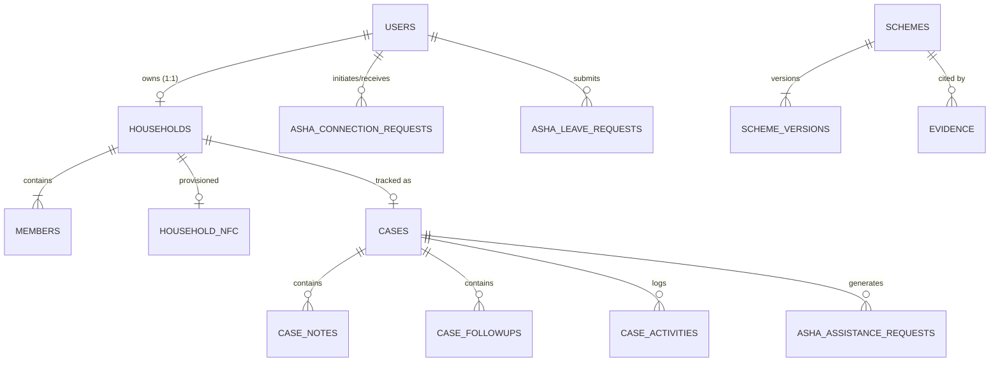

# SwasthyaSetu — Master Project Context & Architectural Specification

> **Document Type:** Master Context, Technical Specification, Operational Architecture & Product Roadmap  
> **Target Audience:** Team Members, Hackathon Judges, Full-Stack Engineers, AI Coding Agents, Mentors, and Presenters  
> **System Classification:** Assisted Digital Public Health Infrastructure & Entitlement Delivery Platform  
> **Authoritative Location:** `/SWASTHYASETU_MASTER_CONTEXT.md` (Project Root)  
> **Last Updated:** September 2026  

---

## Table of Contents

1. [SwasthyaSetu — Explained Like I'm Five](#1-swasthyasetu--explained-like-im-five)
2. [One-Sentence and 30-Second Explanations](#2-one-sentence-and-30-second-explanations)
3. [The Problem](#3-the-problem)
4. [The Solution](#4-the-solution)
5. [Real-World User Journeys](#5-real-world-user-journeys)
6. [Who Uses SwasthyaSetu?](#6-who-uses-swasthyasetu)
7. [Core Features Inventory](#7-core-features-inventory)
8. [Healthcare Scheme System & Deterministic Rule Engine](#8-healthcare-scheme-system--deterministic-rule-engine)
9. [Artificial Intelligence Architecture](#9-artificial-intelligence-architecture)
10. [Voice & Interactive Telephony System](#10-voice--interactive-telephony-system)
11. [Near Field Communication (NFC) Architecture](#11-near-field-communication-nfc-architecture)
12. [Complete Technology Stack](#12-complete-technology-stack)
13. [End-to-End System Architecture](#13-end-to-end-system-architecture)
14. [Backend Architecture & Middleware Design](#14-backend-architecture--middleware-design)
15. [Database Architecture & Cloud Firestore Data Model](#15-database-architecture--cloud-firestore-data-model)
16. [Security, Privacy & IDOR Protection](#16-security-privacy--idor-protection)
17. [ASHA Leave Coverage & Temporary Reassignment Subsystem](#17-asha-leave-coverage--temporary-reassignment-subsystem)
18. [API & Implementation Overview](#18-api--implementation-overview)
19. [Testing & Verification Status](#19-testing--verification-status)
20. [Current Known Limitations](#20-current-known-limitations)
21. [Deployment Architecture & Infrastructure](#21-deployment-architecture--infrastructure)
22. [Market & Public Health Adoption Strategy](#22-market--public-health-adoption-strategy)
23. [Sustainable Business & Institutional Model](#23-sustainable-business--institutional-model)
24. [Architectural Differentiation](#24-architectural-differentiation)
25. [Scalability Engineering](#25-scalability-engineering)
26. [Future Development Roadmap](#26-future-development-roadmap)
27. [Hackathon Live Demonstration Flow](#27-hackathon-live-demonstration-flow)
28. [Judges' Frequently Asked Questions (FAQ)](#28-judges-frequently-asked-questions-faq)
29. [Brutally Honest Status: What Is Built vs Prototype vs Planned](#29-brutally-honest-status-what-is-built-vs-prototype-vs-planned)
30. [Quick Reference Cheat Sheet](#30-quick-reference-cheat-sheet)

---

# 1. SwasthyaSetu — Explained Like I'm Five

### The Story of Ramesh and His Mother
Imagine a family living in a village. The father, Ramesh, works hard every day. His 72-year-old mother, Kamala, starts feeling unwell and needs a hospital visit that could cost ₹40,000. Ramesh is terrified because he does not have that kind of savings.

At the exact same time, the Government of India has a special healthcare program that gives Kamala **100% free hospital treatment up to ₹5 Lakhs every single year**, simply because she is over 70 years old. 

Why doesn't Ramesh know this?
- Nobody gave him a simple letter in his own language.
- Government rules are written in 50-page legal documents filled with legal and bureaucratic words.
- Ramesh does not have a computer, does not understand complex websites, and cannot read English or formal Hindi.
- If he asks a middleman at the bus stop, the middleman might charge him ₹2,000 just to fill out an application.

**This is why millions of families miss out on free government healthcare:** Not because the schemes do not exist, but because normal people cannot discover them, understand the rules, gather the right documents, or connect with someone who can help them.

---

### What Does SwasthyaSetu Do?
**SwasthyaSetu** literally means **"Health Bridge"**. It is a friendly digital assistant and community bridge that connects families to the government health benefits they are legally entitled to receive.

It works in four simple steps:

1. **You tell it who lives in your house:** Ramesh (42, son), Sunita (38, pregnant wife), and Kamala (72, mother).
2. **The system checks official rules instantly:** Like an honest calculator, it looks at the rules:
   - *Is anyone 70 or older?* Yes! Kamala qualifies for **Ayushman Bharat Senior Citizen (70+)** free hospital care!
   - *Is anyone pregnant?* Yes! Sunita qualifies for **Janani Suraksha Yojana (JSY)** and **PMMVY** cash support!
3. **It tells you exactly what to do next:** *"Get Kamala's Aadhaar card ready. Sunita needs her Mother and Child Protection (MCP) card."*
4. **It connects you to your local village healthcare worker (ASHA didi):** With one tap or phone call, your local ASHA worker receives an alert on her phone: *"Ramesh's family needs help making an Ayushman Card for grandmother Kamala."* The ASHA worker visits the house, helps with the paperwork, and tracks the case until the card is in their hands.

---

### Everyday Real-World Questions Answered in Plain English

#### What if the family does not own a smartphone or know how to use a website?
They do not need one. SwasthyaSetu provides two bridges for people without smartphones or internet:
1. **The Ordinary Phone Call (Helpline):** Anyone can dial a regular telephone number from an old button feature phone. An AI voice speaks to them gently in Kannada, Hindi, or English. They can speak back in their regular mother tongue: *"My mother is 72 years old. Can she get hospital help?"* The voice answers clearly and tells them what to do.
2. **The Household Digital Facilitator:** In almost every family or neighborhood, there is a teenager, daughter, nephew, or village shopkeeper with a basic smartphone. They can set up the household in two minutes for their parents or elders.

#### What is the NFC Card?
When the ASHA worker visits the family, she hands them a simple plastic card or sticker called an **NFC Card** (the exact same tap-and-pay chip used in metro passes and credit cards). 
- Whenever anyone taps that card against a smartphone, the phone screen immediately displays a simple family health benefit page in their language: who is eligible, which schemes apply, and the name of their local ASHA worker.
- **The card stores ZERO medical secrets, ZERO passwords, and ZERO private bank details.** If the card drops in the mud or gets stolen, nobody can steal their medical history or money. It is simply a safe physical key that points to the family's public entitlement summary.

#### How does the computer know which schemes a family qualifies for?
It does **NOT** let an AI guess or make things up. AI models can hallucinate or give false medical/legal advice. 
Instead, SwasthyaSetu uses a **Deterministic Rule Engine**. Think of it like a train track:
- If Rule = `Age >= 70`, and Kamala's age is `72`, the answer is **TRUE**. 
- The system shows the exact government rule and official notification so everyone knows it is 100% accurate.

#### What does the ASHA worker do?
The ASHA worker (Accredited Social Health Activist) is the frontline village healthcare hero. Instead of carrying heavy, dog-eared paper registers, she opens her SwasthyaSetu workspace on her phone. She sees:
- Families who have urgent health gaps (e.g., an unimmunized newborn or an unregistered pregnancy).
- Assistance requests sent by families asking for doorstep help.
- Her calendar of upcoming home visits and follow-ups.

#### What happens if the ASHA worker goes on leave or gets sick?
In real life, ASHA workers fall ill, take maternity leave, or travel for family events. When an ASHA worker requests leave, the health administrator approves a temporary backup worker. All the households are safely transferred to the backup worker for that week. When the original worker returns, the system automatically restores her households. Nobody is left forgotten.

---

# 2. One-Sentence and 30-Second Explanations

## One-Line Explanation
> **SwasthyaSetu is a last-mile digital public health platform that deterministically matches vulnerable households to government healthcare entitlements, providing voice-assisted, NFC-enabled, and ASHA-coordinated doorstep care delivery.**

## 30-Second Explanation (For Hackathon Judges)
> "In India, hundreds of millions of citizens qualify for life-saving welfare health schemes like Ayushman Bharat, but miss out due to language barriers, complex rules, missing documents, and digital exclusion.  
> **SwasthyaSetu** fixes this. Citizens or their local ASHA workers profile their household once. Our deterministic engine computes 100% explainable eligibility without AI hallucination.  
> For citizens without smartphones, we provide ordinary phone helpline access powered by Indian-language voice AI and tap-and-go NFC household health cards. When help is needed, it triggers a real-world case for the village ASHA worker to visit, resolve document blockers, and track healthcare delivery from doorstep to hospital."

## 2-Minute Explanation (Problem → Solution → Users → Technology → Impact)
- **The Problem:** The Government of India runs the world's largest healthcare entitlements (e.g., AB-PMJAY offering ₹5 Lakhs per family, and universal coverage for seniors 70+). Yet, rural and low-income families remain unassisted because scheme rules are fragmented, documents are missing, and over 60% of rural citizens cannot navigate complex digital portals.
- **The Solution:** SwasthyaSetu bridges this last mile. It combines a deterministic eligibility engine with an active frontline workforce management platform. It does not replace the human worker; it supercharges the ASHA worker with automated gap detection, digital caseload drawers, and follow-up tracking.
- **The Users:** Citizens discover entitlements; ASHA workers manage field caseloads; Health Administrators oversee platform-wide healthcare equity and worker leave coverage; and non-smartphone users interact via native voice phone calls or household NFC cards.
- **The Technology:** Next.js 16 frontend with Tailwind CSS tokens; Fastify 5 TypeScript backend; Cloud Firestore; deterministic pure-logic rule engine; real-time full-duplex Exotel carrier telephony streaming into Sarvam Indic AI (Saaras STT and Bulbul TTS) across Kannada, Hindi, and English; Google Gemini 2.5 Flash as a conversational explainer (never an eligibility decider); and NDEF NTAG213 Web NFC hardware integration.
- **The Impact:** It transforms passive welfare policies into proactive, doorstep-delivered healthcare rights.

## Elevator Pitch
> *"Every year, millions of Indian families fall into medical poverty because they didn't know a government scheme would have paid for their surgery. SwasthyaSetu turns complex government gazettes into actionable doorstep care—combining simple household profiles, zero-hallucination rule checks, vernacular telephone hotlines, and tap-and-go NFC cards with local ASHA health workers to guarantee no family is left behind."*

---

# 3. The Problem

Public healthcare welfare in India represents one of the largest safety nets in human history. Programs like **Ayushman Bharat Pradhan Mantri Jan Arogya Yojana (AB-PMJAY)**, **Janani Suraksha Yojana (JSY)**, and **Pradhan Mantri Matru Vandana Yojana (PMMVY)** provide critical financial protection against catastrophic health expenditures.

However, a structural chasm exists between national policy formulation and rural doorstep realization:

```
┌─────────────────────────────────┐
│   CENTRAL & STATE GOVERNMENTS   │
│  Enact progressive health rules │
│  (₹5 Lakhs/yr, Senior 70+ cover)│
└────────────────┬────────────────┘
                 │
           THE LAST-MILE CHASM
           ├── 1. Linguistic & Literacy Barriers (Complex legal gazettes)
           ├── 2. Information Asymmetry (Families unaware of 70+ universal cover)
           ├── 3. Documentation Gaps (Missing MCP cards, unlinked Aadhaar)
           ├── 4. Overburdened Frontline ASHAs (Dozens of paper registers)
           └── 5. Digital Exclusion (60%+ lack PC/high-speed smartphone literacy)
                 │
┌────────────────▼────────────────┐
│   VULNERABLE CITIZEN HOUSEHOLD  │
│  Suffers catastrophic medical   │
│  debt or hospital turnaways     │
└─────────────────────────────────┘
```

### Specific Friction Points Solved by SwasthyaSetu
1. **Lack of Awareness of Healthcare Schemes:** Citizens only discover schemes during acute medical emergencies in hospital waiting rooms, when it is too late to obtain approvals.
2. **Difficulty Understanding Eligibility Matrices:** Criteria intersect across socio-economic categories (BPL, Antyodaya Anna Yojana [AAY], NFSA), age thresholds (e.g., universal senior 70+ irrespective of income), maternal parity, and state residency.
3. **Language Barriers:** Official circulars are published in formal English or high-register official Hindi. Vernacular-speaking citizens in states like Karnataka (Kannada) or rural districts cannot decipher their entitlements.
4. **Digital Accessibility & Hardware Constraints:** Web portals assume high-speed 4G/5G smartphones, touchscreens, and digital literacy. Elderly and rural citizens are systematically disenfranchised.
5. **Dependence on Rent-Seeking Intermediaries:** Touts and unauthorized cyber-café operators charge exorbitant fees to print cards or check eligibility.
6. **Difficulty Tracking Assistance & Incomplete Paperwork:** Families often possess 80% of required documents (e.g., Aadhaar card) but miss the remaining 20% (e.g., Mother-Child Protection book or e-KYC photo verification), resulting in claim rejections.
7. **Frontline ASHA Worker Burnout:** Over 1 million ASHA workers manually track households using physical paper ledgers, with zero proactive alerting when a high-risk pregnancy goes unmonitored or an elderly resident misses annual checkups.
8. **Fragmented, Unauditable Administrative Information:** District health officers lack real-time digital visibility into community caseload distribution, overdue patient interactions, and field bottlenecks.

---

# 4. The Solution

SwasthyaSetu provides a unified, multi-channel platform that synchronizes citizens, community health workers, and administrators through a cohesive system architecture:

```
┌───────────────────────────────────────────────────────────────────────────────────────────┐
│                                    SWASTHYASETU PLATFORM                                  │
├────────────────────────────┬─────────────────────────────┬────────────────────────────────┤
│      CITIZEN CHANNELS      │       FRONTLINE ASHA        │     ADMINISTRATIVE GOVERNANCE  │
├────────────────────────────┼─────────────────────────────┼────────────────────────────────┤
│ • Mobile-First Citizen Web │ • ASHA Caseload Workspace   │ • District Platform Caseload   │
│ • Vernacular UI (EN/KN/HI) │ • Digital Household Drawers │ • Workforce Directory          │
│ • Ordinary PSTN Phone Voice│ • Health Gap Triage Alerts  │ • Scheme & Version Registry    │
│ • Tap-and-Go NFC Card      │ • Doorstep Assistance Queue │ • Official Evidence Citations  │
│ • Grounded AI Explainer    │ • Field Notes & Follow-ups  │ • Leave & Delegation Approval  │
│ • Direct ASHA Help Request │ • NFC Tag Provision & Write │ • Real-Time Health Telemetry   │
└────────────────────────────┴─────────────────────────────┴────────────────────────────────┘
```

### Core Components & Why They Exist
- **Citizen Portal (`/citizen`):** A clean, mobile-first interface allowing families to manage their household roster, discover matching entitlements, view customized document checklists, and directly contact their assigned ASHA worker.
- **ASHA Portal (`/asha`):** A field operational dashboard for community workers to triage urgent health alerts, inspect family medical indicators, record home-visit notes, schedule reminders, and issue physical NFC cards.
- **Admin Portal (`/admin`):** A supervisory console for district health officers to monitor caseload equity, approve ASHA leave requests, reassign cases, audit evidence citations, and inspect system telemetry.
- **Interactive PSTN Voice Gateway (`08047289440`):** An inbound/outbound phone helpline that lets citizens call from ordinary feature phones without internet to check benefits in Kannada, Hindi, or English.
- **Deterministic Scheme Registry & Rule Engine:** A pure-logic mathematical evaluator that executes boolean rule trees against household demographics with zero AI hallucinations.
- **Official Evidence & Verification Layer:** Cites verified government notifications, gazettes, and official URLs for every active eligibility rule.
- **Physical NFC Card Subsystem (`/nfc`):** Low-cost, battery-free NTAG213 cards given to households, allowing instant retrieval of public benefit summaries upon tapping with any smartphone.
- **Doorstep Assistance Request Engine:** A structured communication pipe allowing citizens to click "Get Help from ASHA Worker" to request document verification, hospital navigation, or scheme card creation.
- **Automated ASHA Leave & Temporary Reassignment Subsystem:** A workflow where an ASHA worker's caseload is automatically delegated to an approved replacement worker during leave and safely restored upon return.
- **Role-Based Access Control (RBAC):** Server-enforced identity boundaries strictly separating Citizens, ASHA workers, and Administrators.

---

# 5. Real-World User Journeys



### Detailed Breakdown of Workflows

#### 1. Citizen Journey
1. **Discovery:** Citizen visits SwasthyaSetu on a mobile browser or gets introduced by a neighbor or ASHA worker.
2. **First-Time Onboarding:** Signs in via phone or email, reads the DPDP Act statutory data consent at `/auth/consent`, and agrees.
3. **Atomic Household Setup:** Submits household location (village, district, state), socio-economic category (BPL, AAY, APL), ration card number, and Head-of-Household details in a single form.
4. **Family Roster:** Adds spouse, children, and elderly parents with ages, gender, and health badges (maternal status, disability).
5. **Instant Entitlement Calculation:** The system instantly matches them with programs like Ayushman Bharat Senior Citizen (70+) and displays a clear explanation: *"Kamala qualifies because she is 72 years old."*
6. **Action Guidance:** Citizen views a personalized checklist: *"Carry Kamala's Aadhaar card to the nearest PHC or CSC center."*
7. **ASHA Linkage:** Citizen enters the local ASHA worker's public service code (`ASHA-KA-VE2G`), verifies her name, and clicks **"Request Connection"**.
8. **Doorstep Assistance:** Citizen clicks **"Get Help from ASHA Worker"** on the PM-JAY card. They track the status as it moves from `Pending` $\to$ `In Progress` $\to$ `Resolved`.

#### 2. ASHA Worker Journey
1. **Authorized Registration:** ASHA registers with an authorized administrative staff code. The system generates a collision-resistant, shareable **ASHA Service Code** (e.g., `ASHA-KA-VE2G`).
2. **Caseload Directory:** In the ASHA portal (`/asha`), she views all assigned households in her village.
3. **Health Gap Triage:** The system flags households with critical gaps: *"Pregnant woman with missing MCP registration"* or *"Unenrolled 70+ senior citizen"*.
4. **Connection Acceptance:** ASHA opens the **Requests** tab, reviews incoming household connection requests, and clicks **"Accept & Add to Caseload"**, atomically creating an authoritative field case.
5. **Assistance Handling:** Reviews citizen assistance requests, opens the comprehensive **Case Detail Drawer** (with 6 tabs: Household Info, Healthcare Gaps, Eligible Schemes, Case Notes, Follow-ups, and Audit Trail).
6. **Doorstep Visit & Notes:** Visits the home, helps upload or verify documents, types a timestamped field note (`"Verified Aadhaar at PHC, golden card issued"`), and resolves the request.
7. **Scheduling Follow-ups:** Schedules a reminder for next month's child immunization.
8. **NFC Card Provisioning:** Taps a new plastic NFC card to the back of her Android smartphone to permanently link the card to the family.

#### 3. Administrator Journey
1. **Governance Access:** Logs in using an administrative authorization secret.
2. **Platform Telemetry:** Monitors platform-wide active cases, registered households, scheme counts, and evidence conflicts.
3. **Caseload Supervision:** Inspects caseload distribution across ASHA workers. If one worker has 80 households and another has 20, the admin can reassign cases.
4. **Leave Governance:** Reviews pending ASHA leave requests, verifies replacement worker availability, and confirms temporary caseload delegation.
5. **Scheme & Evidence Auditing:** Reviews government policy notifications, inspects Tavily web evidence citations, and verifies that active eligibility rules match the latest gazette releases.

#### 4. Voice Interaction Journey (Interactive Telephony)
1. **The Inbound Call:** An elderly citizen dials the SwasthyaSetu helpline number (`08047289440`) from a feature phone.
2. **Carrier Connection:** Exotel cloud telephony receives the call and connects to the Fastify backend WebSocket stream (`/api/v1/voice/stream`).
3. **Bilingual Greeting:** The caller hears a warm audio greeting in Hindi or Kannada.
4. **Voice Recognition:** The caller speaks: *"Meri maa 72 saal ki hain, kya unhe koi sarkari suvidha mil sakti hai?"*
5. **Transcoding & STT:** Audio frames (8kHz μ-law) are converted to linear PCM and streamed to **Sarvam AI (Saaras:v3)** for Indic speech recognition.
6. **Intent & Fact Retrieval:** The backend NLU recognizes the intent `SCHEME_INQUIRY`, retrieves the factual rule for Senior Citizen 70+ PM-JAY cover, and crafts a concise response.
7. **Speech Synthesis:** **Sarvam AI (Bulbul:v3)** generates clear audio speech in the caller's language.
8. **Turn-Taking Behavior:** The system finishes speaking, plays a chime, and **explicitly waits for caller input**. It does not cut off the user or loop into fallback messages.
9. **Identity Elevation:** If the caller asks for personal family records, the voice assistant politely asks: *"Please tell me the last 4 digits of your Ration Card."* Once matched, personal case updates are spoken.

#### 5. NFC Card Journey (Physical-to-Digital Bridge)
1. **Provisioning:** The ASHA worker clicks **"Register NFC Card"** on a household's case drawer.
2. **Secure Token Generation:** The backend generates a cryptographically random 16-byte token, hashes it with SHA-256 for database storage, and returns the raw token to the ASHA's phone **once**.
3. **Physical Write:** The ASHA taps an NTAG213 card to her phone. Android Chrome writes an NDEF record:  
   `https://<domain>/nfc?hh=hh_<ownerUid>&t=<token>`
4. **Doorstep Tap by Family:** The family hangs the card on their wall. When tapped with any smartphone, the browser opens `/nfc`.
5. **Rate-Limited Hash Resolution:** The backend receives the token, hashes it, checks rate limits, and uses constant-time comparison to verify the card.
6. **Privacy-Minimal Public Summary:** The phone displays:
   - Household Family Name (e.g., *"Sharma Household"*)
   - Region (Village, District, State)
   - High-level list of eligible schemes (e.g., *"Ayushman Bharat, Janani Suraksha"*)
   - Assigned ASHA Worker Name and official contact code
7. **Strict Security Isolation:** The NFC tap **NEVER** displays Aadhaar numbers, income, medical notes, or sensitive documents, and **NEVER** logs the user into the private authenticated citizen portal. To edit or view private data, the citizen must click "Log In to Full Portal" and authenticate.

---

# 6. Who Uses SwasthyaSetu?

| User Group | Primary Role & Real-World Context | What They Can Access & Do | Authentication & Access Channel |
|---|---|---|---|
| **Citizen** | Individual household head or family member seeking healthcare support for their household. | • Manage household profile & family roster.<br>• View deterministic eligibility & document checklists.<br>• Discover & link with local ASHA worker via service code.<br>• Submit assistance requests for scheme enrollment.<br>• Request voice callbacks or chat with AI explainer. | Firebase Auth (Email/Password or Phone OTP) via `/citizen` on standard mobile/desktop browsers. |
| **Household Digital Facilitator** | A digitally literate family member (teenager, adult child, or trusted neighbor) assisting illiterate or non-smartphone family members. | • Same access as Citizen, acting on behalf of the household.<br>• Sets up profile, adds family members, reads instructions aloud to elders.<br>• Digital literacy of elders is **NOT** a prerequisite for receiving care. | Uses Citizen login on their smartphone during family visits. |
| **ASHA Worker** | Frontline community health worker (Accredited Social Health Activist) serving a rural or peri-urban village sector. | • View assigned community caseload directory.<br>• Triage urgent healthcare access gaps (unvaccinated, pregnant, senior).<br>• Accept/decline household connection requests.<br>• Inspect 6-tab case drawers, log field notes, schedule home visits.<br>• Provision, write, rotate, and revoke household NFC cards.<br>• Submit leave requests with automated coverage delegation. | Staff registration with authorized staff secret code; access via `/asha`. |
| **Administrator** | District/Block Health Officer, Medical Officer, or Program Manager overseeing regional public health. | • Monitor platform-wide caseloads and healthcare equity.<br>• Reassign cases between ASHA workers.<br>• Review and approve ASHA leave requests.<br>• Inspect scheme registry, version histories, and evidence citations.<br>• Monitor real-time telephony, voice pipelines, and system telemetry. | Admin registration with authorized administrative secret code; access via `/admin`. |
| **Super Administrator** | Platform system architect or senior state health ministry technical administrator. | • Configure system parameters, API secrets, and encryption keys.<br>• Audit complete system activity logs and evidence conflicts.<br>• Execute database maintenance, backups, and scheme version publishing. | Multi-factor privileged administrative credentials; access via `/admin` and cloud console. |

### The Concept of the "Household Digital Facilitator"
In low-income and rural communities across India, smartphone ownership and digital literacy are rarely uniform across all family members. While elderly grandparents and illiterate parents may not navigate web portals, almost every extended household includes a **Household Digital Facilitator**—a school-going teenager, a college student, a literate daughter, or a local common service center (CSC) operator. 

SwasthyaSetu is deliberately architected so that:
- Digital literacy is **never** a prerequisite for receiving government healthcare benefits.
- A facilitator can set up the household profile in 3 minutes on any browser.
- Once set up, the household can be accessed via an **NFC tap** by anyone with a phone, or via an **ordinary voice call** by the elders themselves.

---

# 7. Core Features Inventory

| Feature | What It Is | Why It Exists | Who Uses It | How It Works | Current Status |
|---|---|---|---|---|---|
| **Atomic Citizen Onboarding** | One-step creation of household and head-of-household member in a single database transaction. | Eliminates partial registrations and orphan records if a user drops connection midway. | Citizens | Submits household address, socio-economic category, ration card number, and head member details atomically via `batch.commit()`. | **IMPLEMENTED** |
| **1:1 Citizen ↔ Household Invariant** | Strict architectural guarantee that one citizen account owns exactly one household with deterministic ID `hh_${ownerUid}`. | Prevents duplicate profiles, split family records, and identity confusion. | Citizens, Backend | Server derives identity strictly from JWT; returns `409 Conflict` (`HOUSEHOLD_ALREADY_EXISTS`) on duplicate creation attempts. | **IMPLEMENTED** |
| **Deterministic Eligibility Engine** | Pure-logic rule engine evaluating central and state healthcare schemes without AI guessing. | Eliminates AI hallucinations, ensuring 100% explainable, legally auditable decisions. | Citizens, ASHA, Admin | Compares household and member attributes against versioned boolean rule sets in `/schemes/{id}/versions/{v}`. | **IMPLEMENTED** |
| **Healthcare Gap Detection** | Evaluates household roster to identify missing coverage (e.g., senior 70+ without golden card, pregnant woman without JSY). | Turns passive welfare directories into proactive, actionable alerts. | Citizens, ASHA | Analyzes matched vs unmet criteria and outputs prioritized urgency badges (`URGENT`, `HIGH`, `NORMAL`). | **IMPLEMENTED** |
| **ASHA Collision-Resistant Service Code** | Unique, shareable worker code (e.g. `ASHA-KA-VE2G`). | Enables citizens to find their local ASHA worker without leaking private phone numbers or UIDs. | Citizens, ASHA | Automatically generated on ASHA registration; searchable via privacy-sanitized directory endpoint. | **IMPLEMENTED** |
| **Household Connection Lifecycle** | Citizen requests connection via code; ASHA accepts; system binds household to ASHA caseload. | Ensures ASHA workers maintain explicit, authorized operational caseloads. | Citizens, ASHA | Manages request lifecycle (`PENDING` $\to$ `ACTIVE`) in `/asha_connection_requests` and creates authoritative `/cases`. | **IMPLEMENTED** |
| **Doorstep Assistance Request Workflow** | Citizens click "Get Help" on specific schemes; creates tracked queue for ASHA. | Bridges digital discovery to physical field assistance for card creation and hospital visits. | Citizens, ASHA | Saved in `/asha_assistance_requests`; ASHA updates status (`IN_PROGRESS`, `RESOLVED`) with timestamped notes. | **IMPLEMENTED** |
| **ASHA Caseload & 6-Tab Case Drawer** | Digital workspace displaying assigned households, gaps, notes, follow-ups, and audit history. | Replaces cumbersome paper registers with an organized mobile workstation. | ASHA Workers | React drawer fetching `/cases/{id}` and nested subcollections (`notes`, `followups`, `activities`). | **IMPLEMENTED** |
| **Deprecation of ASHA Household Creation** | ASHA household registration UI removed; backend blocks `POST /api/v1/asha/cases` with `403 FORBIDDEN_ROLE`. | Prevents duplicate data silos and guarantees that citizens own their household records. | ASHA, Backend | Enforces separation: Citizens create households; ASHA workers manage assigned caseloads. | **IMPLEMENTED** |
| **ASHA Leave & Temporary Delegation** | Submits leave request; admin approves replacement; system reassigns cases and restores them upon return. | Prevents community healthcare abandonment when a frontline worker is sick, on leave, or in training. | ASHA, Admin | Fastify service managing `/asha_leave_requests` and `/asha_temporary_assignments` with audit logging. | **IMPLEMENTED** |
| **NFC Card Provisioning & Web NFC Writer** | ASHA writes secure URL to NTAG213 cards using Android Chrome Web NFC. | Provides battery-free, offline-ready physical health cards for low-income households. | ASHA Workers | Browser writes minimal NDEF URL (<117 bytes) with single retry on transient `NetworkError`. | **IMPLEMENTED** |
| **NFC Public Resolver & Simplified View** | Rate-limited public endpoint resolving NFC token into safe, bilingual household summary. | Allows anyone tapping the card to see eligible schemes and ASHA contacts without revealing PII. | Anyone tapping card | Receives `hh` and `t` query params, verifies SHA-256 hash using `timingSafeEqual`, enforces 10 req/min rate limit. | **IMPLEMENTED** |
| **Two-Phase NFC Rotation & Revocation** | Replaces lost or damaged cards without dropping active coverage until the new card is confirmed. | Handles lost, damaged, or stolen physical tags cleanly and securely. | ASHA Workers | State machine: `ACTIVE` $\to$ `PENDING_WRITE` $\to$ `confirmRotateNfc()` revokes old card and activates new card. | **IMPLEMENTED** |
| **Interactive Telephony (Exotel + Sarvam)** | Carrier phone hotline (`08047289440`) with real-time WebSocket streaming, Indic STT and TTS. | Extends platform access to feature phone users with zero smartphone or data requirements. | Non-smartphone citizens | Full-duplex WebSocket stream transcoding 8kHz μ-law audio to Sarvam Saaras STT and Bulbul TTS. | **IMPLEMENTED** |
| **Conversational Turn-Taking & Echo Suppression** | Smart voice gateway that discards caller audio while speaking, plays chime, and waits for speech. | Prevents frustrating interruptions, audio feedback loops, and premature "Sorry, I didn't understand" retries. | Phone callers | Tracks `isPlayingOutbound`, waits for Exotel `mark` playback signal, arms `noSpeechTimer`, caps fallbacks at 3. | **IMPLEMENTED** |
| **Fail-Closed Voice Privacy Gate** | Inbound voice callers can only access public scheme facts until verifying the last 4 digits of Ration Card. | Protects sensitive health and family records from unauthorized phone snooping. | Phone callers | Enforces state machine: `UNVERIFIED` (public info only) $\to$ `VERIFIED` (personal eligibility & visit tasks). | **IMPLEMENTED** |
| **Grounded AI Field Assistant (Gemini)** | Conversational drawer explaining scheme benefits, hospital processes, and document needs. | Provides human-like conversational explanations grounded strictly in verified scheme facts. | Citizens, ASHA | Powered by Google Gemini 2.5 Flash via `@google/genai`; system prompt strictly forbids guessing eligibility. | **IMPLEMENTED** |
| **Official Evidence & Gazette Registry** | Curated catalog of government circulars, gazettes, policy URLs, and authority scores. | Grounds every scheme rule in official state and national documentation. | Admin | Persisted in `/evidence`; verified citations linked to versioned rule sets. | **IMPLEMENTED** |
| **External Legal Document Search (Tavily)** | Backend-only search discovering government circulars from official `.gov.in` and `.nic.in` domains. | Accelerates administrative discovery of newly enacted state policy amendments. | Admin (Backend) | Calls Tavily Search API with strict government domain filters and local caching; human verifies all results. | **IMPLEMENTED** |
| **DPDP Act Digital Consent Enforcement** | Server-side `requireConsent` middleware blocking unconsented users with `403 CONSENT_REQUIRED`. | Complies with India's Digital Personal Data Protection (DPDP) Act 2023. | All Users | Persisted in `/users/{uid}/consent_history` with immutable timestamp and version tracking. | **IMPLEMENTED** |
| **Trilingual UI Localization** | Complete bilingual/trilingual interface supporting English (`en`), Kannada (`kn`), and Hindi (`hi`). | Breaks language barriers for regional citizens and frontline workers. | All Users | React i18n context with zero-dependency native dictionary mappings across all routes and modals. | **IMPLEMENTED** |
| **Outbound Voice Reminder Automation (n8n)** | Webhook triggers calling households for high-priority overdue follow-ups. | Automates patient reminders for immunizations, antenatal checkups, and card renewals. | ASHA, Citizens | Dispatches domain events (`FOLLOW_UP_ESCALATED`) to n8n workflow; calls `POST /api/v1/voice/outbound`. | **PROTOTYPE** |
| **Lyzr AI Agent Prototype** | Early exploratory multi-agent intelligence prototype. | Tested for complex conversational reasoning during initial proof-of-concept phase. | Internal R&D | REST client in `lyzr.service.ts`; superseded by Gemini 2.5 Flash grounded assistant. | **DRAFT / PROTOTYPE** |

---

# 8. Healthcare Scheme System & Deterministic Rule Engine

### Production-Verified Schemes vs Draft Fixtures

SwasthyaSetu maintains a strict boundary between **Authoritative Production-Verified Schemes** and **Development Draft Templates**:

```
                       SCHEME REGISTRY
                              │
              ┌───────────────┴───────────────┐
              ▼                               ▼
    VERIFIED PRODUCTION               DRAFT / FIXTURES
    (Citizen Facing)              (Pending Verification)
    ├── 1. AB-PMJAY Senior 70+    ├── 1. State Health Assurance
    ├── 2. Janani Suraksha (JSY)  ├── 2. JSSK Template
    └── 3. PMMVY Direct Benefit   └── 3. AB-ArK Karnataka
```

#### Authoritative Verified Production Schemes (Citizen & Caseload Facing)
1. **Ayushman Bharat — Pradhan Mantri Jan Arogya Yojana (AB-PMJAY):**
   - **ID:** `ab-pmjay` | **Current Version:** `2026.2`
   - **Universal Senior Citizen 70+ Pathway:** Universal secondary and tertiary hospital cover up to ₹5,00,000 per year for all Indian citizens aged 70 years and above, irrespective of socio-economic status or family income. Distinct Ayushman Vay Vandana card generation via Aadhaar e-KYC.
   - **BPL / SECC Pathway:** Cashless hospital cover for low-income families identified via BPL ration cards or Antyodaya Anna Yojana (AAY).
2. **Janani Suraksha Yojana (JSY):**
   - **ID:** `jsy` | **Current Version:** `2026.1`
   - **Criteria:** Pregnant women aged $\ge 19$ years from low-income households (BPL/AAY).
   - **Benefit:** Direct cash assistance (₹1,400 in rural areas, ₹1,000 in urban areas) for institutional delivery at accredited public and private healthcare facilities.
3. **Pradhan Mantri Matru Vandana Yojana (PMMVY):**
   - **ID:** `pmmvy` | **Current Version:** `2026.1`
   - **Criteria:** Pregnant women or lactating mothers for the first live birth (and additional incentive for second child if female).
   - **Benefit:** Direct Benefit Transfer (DBT) of ₹5,000 in conditional installments linked to antenatal checkups and child immunization milestones.

#### Draft / Development Template Schemes (Strictly Excluded from Active Citizen Decisions)
1. **State Universal Health Assurance Program (`state-health-assurance`):** Draft template modeling generic state top-up coverage; awaiting state-specific gazette legislation integration.
2. **Janani Shishu Suraksha Karyakram (`jssk`):** Draft template modeling 100% cashless delivery, free diagnostics, and free pediatric medications; pending sub-district formulary verification.
3. **Ayushman Bharat - Arogya Karnataka (`ab-ark-karnataka`):** Draft template for Karnataka state-specific co-branding criteria; awaiting final government portal API alignment.

> [!IMPORTANT]
> Draft schemes are marked `status: "DRAFT"` and are strictly excluded from citizen-facing `/api/v1/eligibility/me` responses until their rules, official legal citations, and document workflows are completed.

---

### Why Deterministic Eligibility Matters

In many contemporary hackathon applications, developers pass user data to an LLM with a prompt like: *"Determine if this family qualifies for Ayushman Bharat."*

**SwasthyaSetu considers this approach irresponsible and unacceptable for healthcare welfare.**

```
UNRELIABLE AI APPROACH:
User Data ──────► Large Language Model ──────► "You probably qualify!" (Hallucination Risk)

SWASTHYASETU DETERMINISTIC APPROACH:
Household Data ──► Boolean Rule Engine ──► Matched: age >= 70 (TRUE) ──► 100% Audit Trail
Official Rules ──┘  (Pure Logic)         Failed: income == BPL (N/A)     Legal Explainability
```

1. **Zero Hallucination:** A mathematical rule engine cannot hallucinate eligibility, invent benefits, or misquote income thresholds. If the rule says `age >= 70`, a 72-year-old evaluates to `true`.
2. **Explainability & Transparency:** When a citizen qualifies, the system returns the exact criteria that matched:  
   *"Kamala Sharma matched rule rule_pmjay_senior_70plus: Age 72 is greater than or equal to 70."*
3. **Three-Valued Logic (`ELIGIBLE`, `NOT_ELIGIBLE`, `NEEDS_INFORMATION`):**
   If a family has not entered their ration card status, the system does not falsely declare them ineligible; it marks the status as `NEEDS_INFORMATION` and prompts the user to add the missing field.
4. **Legal & Administrative Auditability:** Every evaluation records the exact `schemeId` and `schemeVersion` (e.g. `2026.2`). If government rules change, versions are bumped, ensuring historical decisions remain traceable.

---

# 9. Artificial Intelligence Architecture

SwasthyaSetu establishes strict, unbreachable architectural boundaries defining exactly where AI is utilized and where it is strictly prohibited:

```
┌─────────────────────────────────────────────────────────────────────────────────────────┐
│                                 AI RESPONSIBILITY MATRIX                                │
├───────────────────────┬──────────────────────┬──────────────────────────────────────────┤
│ Technology / Provider │ Operational Role     │ What It Does & Does NOT Do               │
├───────────────────────┼──────────────────────┼──────────────────────────────────────────┤
│ **Sarvam AI (Saaras)**│ VOICE INPUT (Ears)   │ Transcribes Indic spoken telephony audio. │
│                       │                      │ • DOES NOT parse intent or decide rules. │
├───────────────────────┼──────────────────────┼──────────────────────────────────────────┤
│ **Multilingual NLU**  │ INTENT PARSER (Brain)│ Deterministic keyword & intent matching. │
│                       │                      │ • Pure TypeScript logic; no LLM drift.   │
├───────────────────────┼──────────────────────┼──────────────────────────────────────────┤
│ **Rule Engine**       │ ELIGIBILITY DECIDER  │ Executes boolean rule criteria.          │
│                       │                      │ • ZERO AI INVOLVED. Pure math.           │
├───────────────────────┼──────────────────────┼──────────────────────────────────────────┤
│ **Response Formatter**│ PHRASER              │ Formats concise spoken output.           │
│                       │                      │ • Template-based; prevents hallucination.│
├───────────────────────┼──────────────────────┼──────────────────────────────────────────┤
│ **Sarvam AI (Bulbul)**│ VOICE OUTPUT (Mouth) │ Synthesizes spoken telephony audio.      │
│                       │                      │ • Speaks exact text in native accent.    │
├───────────────────────┼──────────────────────┼──────────────────────────────────────────┤
│ **Google Gemini 2.5** │ CONVERSATIONAL       │ Explains scheme benefits & next steps.   │
│                       │ EXPLAINER            │ • Grounded in retrieved scheme facts.    │
│                       │                      │ • STRICTLY FORBIDDEN from deciding rules.│
├───────────────────────┼──────────────────────┼──────────────────────────────────────────┤
│ **Tavily Search API** │ EVIDENCE FINDER      │ Discovers official government gazettes.  │
│                       │                      │ • Backend only; cached; human verified.  │
├───────────────────────┼──────────────────────┼──────────────────────────────────────────┤
│ **n8n Automator**     │ ASYNC DISPATCHER     │ Orchestrates background reminders/crons. │
│                       │                      │ • Worker only; NOT an authoritative DB.  │
├───────────────────────┼──────────────────────┼──────────────────────────────────────────┤
│ **Lyzr Agent**        │ PROTOTYPE            │ Early agentic proof of concept.          │
│                       │                      │ • Retained for developmental research.   │
└───────────────────────┴──────────────────────┴──────────────────────────────────────────┘
```

### The Healthcare Voice Architecture Formula
$$\text{Sarvam (Ears)} \longrightarrow \text{NLU (Intent)} \longrightarrow \text{Backend (Facts)} \longrightarrow \text{Rule Engine (Eligibility)} \longrightarrow \text{Formatter (Phrasing)} \longrightarrow \text{Sarvam (Mouth)}$$

---

# 10. Voice & Interactive Telephony System

### The Voice Pipeline
SwasthyaSetu operates a production-grade full-duplex conversational voice gateway designed for low-bandwidth rural cellular networks (2G/3G/4G PSTN):

```mermaid
graph LR
    Caller[Citizen on Feature Phone] -- PSTN Dial-in --> Exotel[Exotel Virtual Number: 08047289440]
    Exotel -- 8kHz μ-law WebSocket Stream --> Fastify[Fastify Gateway /api/v1/voice/stream]
    Fastify -- PCM Audio Buffer --> SarvamSTT[Sarvam AI Saaras:v3 STT]
    SarvamSTT -- Vernacular Transcript --> NLU[Deterministic Multilingual NLU]
    NLU -- Intent & Parameters --> Brain[Backend & Rule Engine]
    Brain -- Factual Entitlement Result --> Formatter[Voice Response Formatter]
    Formatter -- Concise Text --> SarvamTTS[Sarvam AI Bulbul:v3 TTS]
    SarvamTTS -- 8kHz Audio Frames --> Fastify
    Fastify -- 160B Frame Chunks --> Exotel
    Exotel -- Spoken Audio --> Caller
```



### Turn-Taking Behavior & Conversational Hygiene
A critical defect in voice bots is cutting off users, repeating *"Sorry, I didn't understand"*, or talking over the caller. SwasthyaSetu implements strict conversational turn-taking:

1. **Outbound Playback Lock (`isPlayingOutbound = true`):** While the assistant is speaking, any inbound audio from the caller is discarded. This eliminates room echo and accidental self-triggering.
2. **Playback Synchronization (`mark` Event):** When the assistant finishes streaming audio chunks, it sends a named `mark` event (e.g., `turn_1`). The gateway waits until Exotel signals that the physical audio playback has finished on the caller's handset.
3. **Explicit Waiting State (`isWaitingForCaller = true`):** The system plays a gentle audio chime and **explicitly enters a waiting state**. It does not assume the caller is silent; it arms a generous `noSpeechTimer` (6–8 seconds).
4. **Energy-Based Voice Activity Detection (VAD):**
   - Transcodes incoming G.711 μ-law audio to Linear 16-bit PCM using a fast lookup table.
   - Calculates Root Mean Square (RMS) energy. Chunks with $\text{RMS} > 300$ are classified as speech.
   - Requires **45 consecutive silent chunks ($\approx 900\text{ms}$)** to mark the end of the caller's turn.
5. **No Infinite Fallback Loops:**
   If the caller speaks an unrecognized phrase, the system increments `consecutiveFallbacks`. 
   - Fallback 1: Re-prompts gently with examples: *"You can ask about Ayushman Bharat or ASHA visits."*
   - Fallback 2: Offers connection to a local healthcare worker.
   - Fallback 3: Concludes the call politely and terminates rather than trapping the caller in a repeating loop.
6. **Safety & Cost Guardrails:** Calls are automatically capped at a maximum of 10 turns and 300 seconds duration to prevent carrier runaway charges.

---

# 11. Near Field Communication (NFC) Architecture

### Layman Explanation
The NFC card is a durable, waterproof plastic card or sticker with an embedded antenna chip (the exact same technology used in contactless payment cards and metro tokens). 
- It requires **no batteries** and has **no moving parts**. It draws power wirelessly from the smartphone that touches it.
- When an ASHA worker issues a card to a family, she taps it once with her phone.
- From that moment on, whenever the family or a healthcare worker taps the card with any smartphone, the phone instantly displays a summary of the family's eligible healthcare schemes and their local ASHA worker's contact details.

---

### Technical & Cryptographic Architecture

```
┌────────────────────────────────────────────────────────────────────────────────────────┐
│                                 NFC DATA ARCHITECTURE                                  │
├────────────────────────────────────────────────────────────────────────────────────────┤
│  PHYSICAL NTAG213 TAG STORES ONLY:                                                     │
│  https://<domain>/nfc?hh=hh_<ownerUid>&t=a1b2c3d4e5f6...                               │
│                                                                                        │
│  [X] NO Patient Names            [X] NO Medical History         [X] NO Income Data     │
│  [X] NO Aadhaar Numbers          [X] NO Passwords               [X] NO Raw Database IDs│
└───────────────────────────────────────────┬────────────────────────────────────────────┘
                                            │ Physical Tap
                                            ▼
┌────────────────────────────────────────────────────────────────────────────────────────┐
│                        PUBLIC RATE-LIMITED RESOLVER (/v1/nfc/resolve)                  │
├────────────────────────────────────────────────────────────────────────────────────────┤
│  1. Receives Household ID and raw 16-byte token string                                 │
│  2. Hashes token using SHA-256: crypto.createHash("sha256").update(token).digest("hex")│
│  3. Compares with stored tokenHash using constant-time crypto.timingSafeEqual          │
│  4. Enforces IP Rate Limiter (Max 10 requests per minute)                              │
│  5. Returns strictly privacy-minimal public summary:                                   │
│     - Household Display Name (e.g. "Ramesh Sharma's Household")                        │
│     - Geographic Jurisdiction (Village, District, State)                               │
│     - Eligible Scheme Names (High-level string array)                                  │
│     - Assigned ASHA Service Code and Public Display Name                               │
└────────────────────────────────────────────────────────────────────────────────────────┘
```

#### Physical Hardware Constraints: Solving the NTAG213 Capacity Bottleneck
During physical hardware testing on Android smartphones with NTAG213 tags, a real-world hardware bottleneck was uncovered:
- **NTAG213 Physical Limit:** 144 bytes total memory; usable NDEF storage is **117 bytes**.
- On cloud preview deployments (e.g., long branch domains like `sih-final-frontend-git-branch-team.vercel.app`), the generated URL reached 121 characters, creating a 118-byte NDEF payload. This exceeded physical tag memory by exactly 1 byte, causing Android OS to throw an unhandled `ERROR_IO` exception.
- **Architectural Resolution Implemented in Codebase:**
  1. `getPublicOrigin()` prioritizes `window.location.origin` (or short custom domain) over long cloud preview domains.
  2. `buildNfcUrl()` omits the default `&v=1` parameter when version is 1, saving 4 crucial bytes.
  3. Real SwasthyaSetu NFC URLs fit under **105 bytes**, writing cleanly with 100% success on NTAG213 tags.
  4. Added `overwrite: true` and an automatic single retry after 250ms on transient Web NFC `NetworkError` coupling slips.

#### NFC Credential Lifecycle & Edge Cases
- **One Active Credential per Household:** Each household record has at most one `ACTIVE` NFC credential.
- **Two-Phase Card Rotation:** If a card is worn out or damaged, the ASHA worker initiates rotation (`POST /api/v1/asha/households/:id/nfc/rotate`). The old card remains active while the new card is marked `PENDING_WRITE`. Only after the new card is physically tapped and verified (`/rotate/confirm`) is the old card revoked and the new card activated. If writing is aborted, `/rotate/cancel` restores the original card.
- **Lost or Stolen Card:** The ASHA worker clicks **"Revoke NFC Card"**. The backend marks the credential `REVOKED`. Subsequent taps on the old card display an error: *"This card has been revoked."* Because the card contains no medical or private data, the finder obtains zero sensitive information.
- **Offline / Internet Unavailable:** To resolve dynamic scheme entitlements, the smartphone tapping the card must have internet connectivity. If internet is unavailable, the phone browser caches the last-known public profile.

---

# 12. Complete Technology Stack

| Architecture Layer | Technology | Version / Specification | Exact Purpose in SwasthyaSetu |
|---|---|---|---|
| **Frontend Framework** | **Next.js** | 16.3.3 (App Router, Turbopack) | Core web application framework, SSR, and dynamic route rendering. |
| **UI Library** | **React** | 19.0.0 | Component rendering, state management, and client interaction hooks. |
| **Language (Frontend)**| **TypeScript** | 5.7+ | Strict end-to-end static type safety shared across client and server. |
| **Styling & Tokens** | **Tailwind CSS** | v4.0 | Responsive design system, accessible color contrasts, neutral tokens. |
| **Iconography** | **Lucide React** | Latest | High-contrast, lightweight SVG icons for medical and operational status. |
| **Backend Runtime** | **Node.js** | v20+ / v22+ LTS | High-performance asynchronous JavaScript/TypeScript execution runtime. |
| **Backend Framework** | **Fastify** | 5.2+ | Lightweight HTTP/WebSocket server daemon with plugin architecture. |
| **WebSocket Engine** | **@fastify/websocket**| Latest | Full-duplex WebSocket stream handler for Exotel real-time telephony. |
| **Schema Validation** | **Zod** | 3.24+ | Runtime schema validation for API inputs, environment vars, and contracts. |
| **Database & Persistence**| **Cloud Firestore** | Server Admin SDK v13+ | Multi-region NoSQL document storage with strict subcollections. |
| **Authentication** | **Firebase Auth** | Client & Admin SDK | Cryptographically signed JWT bearer token management and identity. |
| **Speech Recognition** | **Sarvam AI (Saaras)** | `saaras:v3` (8kHz μ-law) | Telephony speech-to-text transcribing Kannada, Hindi, and English. |
| **Speech Synthesis** | **Sarvam AI (Bulbul)** | `bulbul:v3` (8kHz WAV/μ-law) | Telephony text-to-speech with natural Indic speakers (`roopa`). |
| **Cloud Telephony** | **Exotel Cloud PBX** | Connect REST API & Stream Applet | PSTN virtual phone numbers, inbound call routing, and bidirectional media streams. |
| **Conversational AI** | **Google Gemini** | 2.5 Flash (`@google/genai`) | Grounded conversational assistant explaining scheme facts and procedures. |
| **Policy Search** | **Tavily Search API** | REST API (`.gov.in` domain filter) | Automated discovery of official gazette notices and state health circulars. |
| **Agentic Prototype** | **Lyzr Agent API** | v3 Inference Studio | Experimental multi-agent prototype retained for architecture research. |
| **Workflow Automation**| **n8n** | Webhook Workflow Engine | Asynchronous task dispatcher for overdue follow-ups and escalation crons. |
| **Physical Hardware** | **NTAG213 NFC Tags** | 144B Total / 117B NDEF | Durable contactless PVC cards/stickers storing secure household URLs. |
| **Web Hardware API** | **Web NFC (NDEFReader)**| W3C Candidate Recommendation | Browser-level NFC writing and reading directly from Android Chrome. |
| **Testing Framework** | **Vitest** | 3.0+ | Fast unit and integration test runner with in-memory repository mocks. |
| **Frontend Deployment**| **Vercel** | Edge Network / Serverless | High-availability global deployment target for Next.js frontend. |
| **Backend Deployment** | **Render** | Node.js Native Web Service | Dedicated long-running container service running Fastify and WebSockets. |

> [!NOTE]
> **Groq is NOT used in the codebase.** Inspecting repository dependencies confirms conversational intelligence is powered by Google Gemini (`@google/genai`), speech is powered by Sarvam AI, and early prototypes used Lyzr.

---

# 13. End-to-End System Architecture

```mermaid
graph TD
    subgraph Clients["Access Channels & Hardware"]
        CitBrowser["Citizen Web (Next.js 16)"]
        AshaBrowser["ASHA Web (Next.js 16)"]
        AdminBrowser["Admin Console (Next.js 16)"]
        PhoneCaller["Feature Phone (PSTN Call)"]
        NfcTag["Physical NTAG213 Card"]
    end

    subgraph Edge["Gateway & Telephony Layer"]
        ExotelPBX["Exotel Cloud PBX (08047289440)"]
        FastifyWS["Fastify WebSocket (/voice/stream)"]
        FastifyHTTP["Fastify HTTP REST API (/api/v1)"]
    end

    subgraph Security["Security & Identity Boundary"]
        FirebaseAuth["Firebase Auth (Bearer JWT)"]
        Guards["requireAuth • requireConsent • requireRole"]
        RateLimiter["IP Rate Limiter (NFC Resolve)"]
    end

    subgraph CoreServices["Domain Services (TypeScript)"]
        UserService["UserService"]
        HouseholdService["HouseholdService"]
        RuleEngine["Deterministic Rule Engine"]
        GapService["Healthcare Gap Detection"]
        ConnectionService["ASHA Connection Service"]
        AssistanceService["Assistance Request Service"]
        CaseService["Case Management Service"]
        LeaveService["ASHA Leave & Delegation Service"]
        NfcService["NFC Cryptographic Service"]
        VoiceGateway["Voice Gateway & Turn-Taking"]
    end

    subgraph AIIntegrations["AI & External Integrations"]
        SarvamSTT["Sarvam Saaras:v3 STT"]
        SarvamTTS["Sarvam Bulbul:v3 TTS"]
        GeminiAI["Google Gemini 2.5 Flash"]
        TavilySearch["Tavily Gazette Search"]
        n8nEngine["n8n Webhook Dispatcher"]
    end

    subgraph Persistence["Cloud Firestore (Admin SDK)"]
        UsersCol[("/users/{uid}")]
        HouseholdsCol[("/households/{hhId}")]
        MembersCol[("/households/{hhId}/members")]
        CasesCol[("/cases/{caseId}")]
        AssistanceCol[("/asha_assistance_requests")]
        ConnectionCol[("/asha_connection_requests")]
        LeaveCol[("/asha_leave_requests")]
        NfcCol[("/household_nfc")]
        SchemesCol[("/schemes/{schemeId}")]
        EvidenceCol[("/evidence")]
        VoiceCol[("/voice_sessions")]
    end

    CitBrowser -->|HTTPS + JWT| FastifyHTTP
    AshaBrowser -->|HTTPS + JWT| FastifyHTTP
    AdminBrowser -->|HTTPS + JWT| FastifyHTTP
    NfcTag -.->|Tap URL| CitBrowser
    PhoneCaller -->|PSTN Dial| ExotelPBX
    ExotelPBX -->|WSS Audio| FastifyWS

    FastifyHTTP --> Guards
    FastifyWS --> VoiceGateway
    Guards --> FirebaseAuth

    Guards --> UserService
    Guards --> HouseholdService
    Guards --> ConnectionService
    Guards --> AssistanceService
    Guards --> CaseService
    Guards --> LeaveService
    Guards --> NfcService

    HouseholdService --> RuleEngine
    RuleEngine --> GapService
    NfcService --> RateLimiter

    VoiceGateway --> SarvamSTT
    VoiceGateway --> SarvamTTS
    VoiceGateway --> RuleEngine
    VoiceGateway --> AssistanceService
    FastifyHTTP --> GeminiAI
    FastifyHTTP --> TavilySearch
    CaseService --> n8nEngine

    UserService --> UsersCol
    HouseholdService --> HouseholdsCol & MembersCol
    CaseService --> CasesCol
    AssistanceService --> AssistanceCol
    ConnectionService --> ConnectionCol
    LeaveService --> LeaveCol
    NfcService --> NfcCol
    RuleEngine --> SchemesCol
    TavilySearch --> EvidenceCol
    VoiceGateway --> VoiceCol
```



### Architectural Flow Explained in Plain Language
1. **The Request Ingress:** Requests enter the platform either through HTTPS (from Next.js browsers) or through secure full-duplex WebSockets (from Exotel telephony).
2. **The Security Boundary:** Every HTTP request passes through three mandatory server guards:
   - `requireAuth`: Cryptographically verifies the Firebase ID Token using the server-side Firebase Admin SDK.
   - `requireConsent`: Verifies that the user has signed the statutory DPDP Act data privacy consent.
   - `requireRole`: Enforces role-based permissions (`CITIZEN`, `ASHA`, or `ADMIN`).
3. **The Core Business Layer:** Requests are routed to dedicated TypeScript domain services. For example, when a family roster is updated, `HouseholdService` calls the `Deterministic Rule Engine`, which loads official scheme rules from `/schemes` and calculates eligibility.
4. **The AI & Telephony Integration:** If a voice call arrives, `VoiceGatewayService` receives 8kHz audio, transcribes it via Sarvam AI, resolves the caller's intent, queries the backend for authoritative facts, and returns spoken audio via Sarvam TTS. If a citizen chats with the web field assistant, `GeminiService` provides conversational explanations strictly grounded in retrieved scheme facts.
5. **The Persistence Layer:** Cloud Firestore is accessed **strictly server-side** via the Firebase Admin SDK. Direct client-side reads and writes to domain collections are completely blocked by restrictive `firestore.rules`.

---

# 14. Backend Architecture & Middleware Design

The backend is built as a modular, industrial-grade Fastify 5 daemon adhering to clean-architecture principles:

```
backend/src/
├── app.ts                 # Fastify application factory & plugin registration
├── server.ts              # HTTP & WebSocket listener entrypoint
├── config/
│   ├── env.ts             # Zod-validated environment schema (fails boot on missing vars)
│   └── constants.ts       # HTTP status codes, role enums, and timeouts
├── plugins/
│   ├── correlation.ts     # Injects unique x-correlation-id for distributed tracing
│   ├── cors.ts            # CORS origin restrictions (Next.js client whitelist)
│   ├── errors.ts          # RFC 7807 problem detail envelope mapping
│   ├── firebase.ts        # Firebase Admin SDK initialization
│   ├── auth.ts            # Bearer token parser & userProfile decorator
│   └── guards.ts          # requireAuth, requireConsent, requireRole guards
├── repositories/          # Isolated data access layer with Firestore & in-memory stores
│   ├── base.repository.ts
│   ├── user.repository.ts
│   ├── household.repository.ts
│   ├── case.repository.ts
│   ├── connection.repository.ts
│   ├── assistance.repository.ts
│   ├── leave.repository.ts
│   ├── nfc.repository.ts
│   └── scheme.repository.ts
├── routes/                # Modular REST and WebSocket route controllers
│   ├── auth.ts            # /api/v1/auth/*
│   ├── household.ts       # /api/v1/households/*
│   ├── eligibility.ts     # /api/v1/eligibility/*
│   ├── guidance.ts        # /api/v1/guidance/*
│   ├── connection.ts      # /api/v1/citizen/asha-connection & /asha/directory
│   ├── assistance.ts      # /api/v1/citizen/assistance & /asha/assistance-requests
│   ├── case.ts            # /api/v1/asha/cases & /admin/cases
│   ├── leave.ts           # /api/v1/asha/leave & /admin/leave
│   ├── nfc.ts             # /api/v1/nfc/resolve & /asha/households/:id/nfc
│   ├── voice.ts           # /api/v1/voice/* & WebSocket /voice/stream
│   ├── evidence.ts        # /api/v1/evidence/*
│   └── assistant.ts       # /api/v1/assistant/chat
└── services/              # Pure domain business logic
    ├── household.service.ts
    ├── case.service.ts
    ├── leave.service.ts
    ├── nfc.service.ts
    ├── eligibility/rule-engine.ts
    └── telephony/exotel-stream-gateway.service.ts
```

### Key Architectural Responsibilities
- **Correlation ID Tracking:** Every request receives or carries an `x-correlation-id`. If an error occurs, the client receives this ID to report to administrators, enabling instant log forensics.
- **Fail-Safe Zod Validation:** Request bodies, query parameters, and URL path variables are validated at the route edge using shared Zod schemas. Malformed payloads are rejected with `400 Bad Request` before touching domain services.
- **RFC-Compliant Error Envelopes:** All errors return structured JSON with an HTTP status code, domain error code (e.g. `HOUSEHOLD_ALREADY_EXISTS`), user-friendly message, and correlation ID.
- **In-Memory Repository Doubles:** Repositories implement clean memory fallbacks, enabling the entire 741-test suite to run in ~6 seconds with zero live database dependencies or mock flakiness.

---

# 15. Database Architecture & Cloud Firestore Data Model

SwasthyaSetu utilizes a strictly organized Cloud Firestore NoSQL schema optimized for security, query isolation, and atomic operations:



### Collection Inventory & Schemas

#### 1. `/users/{uid}`
- `uid`: string (Primary Key, matches Firebase Auth UID)
- `email`: string | null
- `phoneNumber`: string | null
- `displayName`: string | null
- `role`: `"CITIZEN"` | `"ASHA"` | `"ADMIN"`
- `consentStatus`: `"accepted"` | `"pending"` | `"revoked"`
- `consentVersion`: string (e.g. `"2026.1"`)
- `consentedAt`: ISO 8601 string
- `ashaServiceCode`: string | null (e.g. `"ASHA-KA-VE2G"`, generated exclusively for ASHA workers)
- `serviceArea`: string | null (e.g. `"Bengaluru Urban, Ward 42"`)

#### 2. `/households/{householdId}` (Document ID = `hh_${ownerUid}`)
- `id`: string (Deterministic ID binding 1:1 to owner UID)
- `ownerUid`: string (Indexed; foreign key to `/users/{uid}`)
- `headOfHouseholdName`: string
- `rationCardNumber`: string
- `incomeCategory`: `"BPL"` | `"AAY"` | `"APL"` | `"OTHER"`
- `state`: string
- `district`: string
- `village`: string
- `pincode`: string
- `contactPhone`: string
- `createdAt`: ISO 8601 string
- **Subcollection:** `/members/{memberId}`:
  - `id`: string
  - `fullName`: string
  - `age`: number (0–125)
  - `gender`: `"male"` | `"female"` | `"other"`
  - `relationship`: `"Head"` | `"Spouse"` | `"Son"` | `"Daughter"` | `"Father"` | `"Mother"` | `"Other"`
  - `disabilityStatus`: boolean
  - `maternalStatus`: `"none"` | `"pregnant"` | `"lactating"`
  - `chronicConditions`: string[]

#### 3. `/cases/{caseId}`
- `id`: string (Foreign key to `householdId`)
- `householdId`: string
- `assignedAshaUid`: string (Foreign key to `/users/{uid}`)
- `headOfHouseholdName`: string
- `status`: `"NEW"` | `"ACTIVE"` | `"NEEDS_ATTENTION"` | `"FOLLOW_UP"` | `"RESOLVED"` | `"CLOSED"`
- `priority`: `"LOW"` | `"NORMAL"` | `"HIGH"` | `"URGENT"`
- `detectedGapsCount`: number
- `eligibleSchemesCount`: number
- `lastContactAt`: ISO 8601 string | null
- `nextFollowUpAt`: ISO 8601 string | null
- `temporaryAssignment`: Object | null (tracks leave delegation metadata)
- **Subcollections:**
  - `/notes/{noteId}`: Field observations by ASHA worker with author UID and timestamp.
  - `/followups/{followUpId}`: Scheduled tasks (`scheduledAt`, `reason`, `status: PENDING | COMPLETED`).
  - `/activities/{activityId}`: Chronological immutable audit trail of all actions taken on the case.

#### 4. `/household_nfc/{id}`
- `id`: string
- `householdId`: string (Unique indexed constraint: 1 active credential per household)
- `ownerUid`: string
- `tokenHash`: string (SHA-256 hash; **raw token is never stored**)
- `status`: `"ACTIVE"` | `"PENDING_WRITE"` | `"REVOKED"` | `"EXPIRED"`
- `version`: number
- `provisionedByAshaUid`: string
- `issuedAt`: ISO 8601 string
- `lastTappedAt`: ISO 8601 string | null

#### 5. Operational Workflow Collections
- `/asha_connection_requests/{id}`: Manages citizen requests to link with an ASHA worker via service code.
- `/asha_assistance_requests/{id}`: Manages citizen scheme assistance requests.
- `/asha_leave_requests/{id}`: Authoritative ASHA leave applications, review status, and delegation parameters.
- `/asha_temporary_assignments/{id}`: Historical ledger of individual cases reassigned due to leave.
- `/asha_leave_audit_logs/{id}`: Immutable audit trail for all leave actions.
- `/voice_sessions/{id}`: State machine tracking telephony calls, audio turns, and verification state.
- `/schemes/{schemeId}` & `/versions/{versionId}`: Authoritative scheme criteria and rule trees.
- `/evidence/{evidenceId}`: Government gazettes, circular citations, and authority scores (1–100).

---

# 16. Security, Privacy & IDOR Protection

### Security in Plain English
- **No Secret Leaks:** Your health information and passwords are never visible to other families or unauthorized workers.
- **The Stolen Card Defense:** If you lose your NFC card on the road, nobody can steal your identity. The card does not contain your medical records, Aadhaar, or phone number.
- **Protection Against Corrupt Middlemen:** No middleman can access your family record without having your official phone number and matching your ration card details.

---

### Technical Security Mechanisms
1. **Server-Derived Identity & Anti-Spoofing:** All authenticated operations derive identity strictly from the cryptographically verified JWT (`request.user.uid`). Any `ownerUid` or `userId` supplied in request bodies is discarded.
2. **Insecure Direct Object Reference (IDOR) Defense:**
   - **Citizens:** Can only query or mutate households where `household.ownerUid === request.user.uid`. Attempting to access another household returns `404 Not Found` or `403 Forbidden`.
   - **ASHA Workers:** Can only access cases where `case.assignedAshaUid === request.user.uid` (or actively delegated under an approved leave request). Cross-ASHA inspection is blocked.
3. **Privileged Registration Secret Hashing:** To prevent unauthorized users from registering as ASHA workers or Administrators, registration requires a pre-shared secret. Secrets are validated using constant-time SHA-256 comparison against server environment variables (`ASHA_REGISTRATION_SECRET_HASH`, `ADMIN_REGISTRATION_SECRET_HASH`).
4. **NFC Cryptographic Token Hashing:**
   - Physical cards store a high-entropy 16-byte random token (`crypto.randomBytes(16).toString("hex")`).
   - The database stores **only the SHA-256 hash**. A database breach exposes zero valid NFC tokens.
   - Verification uses constant-time string comparison (`crypto.timingSafeEqual`) to prevent timing side-channel attacks.
5. **Anti-Enumeration & Public Rate Limiting:** The public NFC resolution endpoint (`POST /api/v1/nfc/resolve`) enforces an IP-based rate limit of **10 requests per minute** to prevent brute-force token enumeration.
6. **Privacy-Minimal Public Serialization:** Public lookups (such as ASHA directory search and NFC resolution) use strict serialization DTOs that explicitly omit internal UIDs, phone numbers, email addresses, and detailed family rosters.
7. **Statutory DPDP Act Consent Gating:** Protected endpoints are guarded by `requireConsent`. Users who have not consented cannot read or write data.
8. **Fail-Closed Voice Gate:** Phone callers are classified as `UNVERIFIED` by default. Access to private family records requires speaking the last 4 digits of the household Ration Card.

---

# 17. ASHA Leave Coverage & Temporary Reassignment Subsystem

In India's primary healthcare system, when an ASHA worker falls ill, goes on maternity leave, or attends training, their community households are frequently abandoned, causing missed immunizations and delayed scheme enrollments. 

SwasthyaSetu implements an automated, auditable leave coverage and caseload delegation subsystem:

```
┌────────────────────────────────────────────────────────────────────────────────────────┐
│                        ASHA LEAVE & DELEGATION LIFECYCLE                               │
├────────────────────────────────────────────────────────────────────────────────────────┤
│ 1. ASHA Submits Leave Request (POST /api/v1/asha/leave)                                │
│    - Validates date range (normalized to IST 23:59:59.999 boundary)                   │
│    - Rejects overlapping active leave requests                                         │
│    - Status set to PENDING; audit event logged                                         │
│                                                                                        │
│ 2. District Admin Reviews & Approves (POST /api/v1/admin/leave/:id/approve)           │
│    - Admin selects an active, validated replacement ASHA worker                        │
│    - Checks replacement worker availability (rejects if replacement is also on leave) │
│    - Atomically reassigns affected cases: case.assignedAshaUid = replacementAsha.uid   │
│    - Records temporary assignment in /asha_temporary_assignments                       │
│    - Appends CASE_TEMPORARILY_REASSIGNED activity on each case                         │
│                                                                                        │
│ 3. Automated Lazy Restoration (evaluateAndRestoreExpiredLeaves)                       │
│    - Evaluated automatically when leave expires                                        │
│    - Verifies original ASHA worker is still active                                     │
│    - SAFETY CHECK: If Admin manually reassigned a case during the leave period, the    │
│      system detects the mismatch, SKIPS automatic restoration, and logs an audit log!   │
│    - Restores untouched cases to original ASHA worker                                  │
│    - Updates leave request to COMPLETED with RESTORED status                           │
└────────────────────────────────────────────────────────────────────────────────────────┘
```

> [!IMPORTANT]
> **This entire workflow is executed deterministically by the Fastify backend and Cloud Firestore.** It does **NOT** rely on external automation tools (like n8n) to maintain state or execute database reassignment.

---

# 18. API & Implementation Overview

All endpoints are prefixed with `/api/v1` and return standard JSON responses.

### 1. Authentication & Identity
- `POST /api/v1/auth/prevalidate` — Validates role registration secrets before user creation.
- `GET /api/v1/auth/me` — Retrieves authenticated user profile, role, and consent status.
- `POST /api/v1/auth/consent` — Submits statutory DPDP Act consent.

### 2. Citizen & Household Management
- `POST /api/v1/households` — Atomically creates household and head member (Citizen only; enforces 1:1 invariant).
- `GET /api/v1/households/me` — Retrieves citizen's household profile.
- `PATCH /api/v1/households/me` — Updates household address or contact details.
- `POST /api/v1/households/me/members` — Adds a family member to the household subcollection.
- `DELETE /api/v1/households/me/members/:id` — Removes a member from the household.

### 3. Scheme Registry & Eligibility
- `GET /api/v1/schemes` — Publicly lists all active healthcare schemes.
- `GET /api/v1/schemes/:id` — Retrieves specific scheme criteria and documentation requirements.
- `GET /api/v1/eligibility/me` — Deterministically evaluates all active schemes for the authenticated household.
- `GET /api/v1/guidance/me` — Generates prioritized healthcare gap actions and document checklists.

### 4. ASHA Caseload & Case Management
- `GET /api/v1/asha/directory/:code` — Public sanitized lookup of ASHA worker by service code.
- `POST /api/v1/citizen/asha-connection/request` — Citizen submits household connection request.
- `GET /api/v1/asha/connection-requests` — ASHA lists incoming connection requests.
- `POST /api/v1/asha/connection-requests/:id/accept` — ASHA accepts request and creates authoritative case.
- `GET /api/v1/asha/cases` — Lists assigned community caseload with filters for gaps and priority.
- `GET /api/v1/asha/cases/:id` — Retrieves comprehensive 6-tab case detail drawer.
- `POST /api/v1/asha/cases/:id/notes` — Appends timestamped field notes to case.
- `POST /api/v1/asha/cases/:id/follow-ups` — Schedules structured home visits and reminders.
- `POST /api/v1/admin/cases/assign` — Admin assigns or reassigns case to an ASHA worker.

### 5. Assistance Requests
- `POST /api/v1/citizen/assistance/request` — Citizen requests help for scheme enrollment or documents.
- `GET /api/v1/citizen/assistance` — Citizen tracks status of submitted assistance requests.
- `GET /api/v1/asha/assistance-requests` — ASHA lists pending assistance queue.
- `PATCH /api/v1/asha/assistance-requests/:id` — ASHA updates status (`IN_PROGRESS`, `RESOLVED`) with response note.

### 6. ASHA Leave Coverage
- `POST /api/v1/asha/leave` — ASHA submits leave request.
- `GET /api/v1/asha/leave/my` — ASHA views own leave history.
- `GET /api/v1/admin/leave` — Admin views all pending and historical leave requests.
- `POST /api/v1/admin/leave/:id/approve` — Admin approves leave and executes bulk temporary reassignment.
- `POST /api/v1/admin/leave/:id/reject` — Admin rejects leave request with reason.

### 7. NFC Tag Management & Public Resolver
- `POST /api/v1/nfc/resolve` — **Public rate-limited endpoint** resolving token into safe household summary.
- `GET /api/v1/asha/households/:id/nfc` — ASHA views household NFC status.
- `POST /api/v1/asha/households/:id/nfc` — ASHA provisions new NFC token.
- `POST /api/v1/asha/households/:id/nfc/rotate` — Initiates two-phase card rotation.
- `POST /api/v1/asha/households/:id/nfc/rotate/confirm` — Confirms write and activates rotated card.
- `POST /api/v1/asha/households/:id/nfc/revoke` — Revokes compromised card.

### 8. Telephony & Artificial Intelligence
- `GET /api/v1/voice/stream` — **Full-duplex WebSocket stream** handling Exotel telephony audio.
- `POST /api/v1/voice/webhooks/exotel/inbound` — Webhook handling incoming carrier calls.
- `POST /api/v1/voice/outbound` — Triggers automated outbound phone calls for overdue follow-ups.
- `POST /api/v1/assistant/chat` — Conversational assistant powered by grounded Google Gemini 2.5 Flash.

---

# 19. Testing & Verification Status

The SwasthyaSetu codebase has undergone rigorous automated testing, static type verification, and end-to-end integration audits.

### Current Verified Test Numbers (Inspected from Codebase)
- **Backend Automated Vitest Test Suite:**
  - **58 Test Files Passed (58 / 58)**
  - **741 Total Automated Tests Passed (741 / 741)**
  - **Test Suite Duration:** ~6.09 seconds.
  - Zero failing tests. Zero skipped test suites.
- **Frontend Production Build:**
  - Next.js 16.3.3 compiled successfully with Turbopack.
  - TypeScript strict typecheck passed with **0 errors**.
  - All 12 production routes statically generated:
    `○ /`, `○ /_not-found`, `○ /admin`, `○ /asha`, `ƒ /asha/cases/[caseId]`, `○ /auth/consent`, `○ /auth/sign-in`, `○ /citizen`, `○ /icon.png`, `○ /nfc`, `○ /unauthorized`.

### Clear Separation of Test Categories
1. **Automated Software Testing (Verified in Repository):**
   - 741 unit and integration tests covering atomic onboarding, 1:1 invariant, IDOR defense, RBAC guards, rule engine evaluations, gap calculations, ASHA leave state machines, NFC hash verification, and telephony WebSocket packet transcoding.
2. **Physical NFC Hardware Testing:**
   - Physical Web NFC writing was tested on Android smartphones using NTAG213 physical chips. Real-world testing revealed the 117-byte NDEF capacity limit, which was resolved by optimizing payload lengths and implementing write retries.
3. **Live Carrier Telephony Testing:**
   - Inbound telephony was configured and tested using Exotel virtual number `08047289440` routed through secure reverse tunnels (`cloudflared`/`ngrok`) to `/api/v1/voice/stream`, verifying real-time Sarvam STT transcription and TTS audio playback over cellular phone lines.

---

# 20. Current Known Limitations

To maintain absolute integrity, the project openly documents its current operational and architectural boundaries:

1. **Internet Dependency for Dynamic NFC Entitlements:** While the physical NFC card requires no battery, the smartphone tapping the card must have cellular data or Wi-Fi to reach the public resolver API. If completely offline, the phone cannot query dynamic Firestore updates.
2. **Web NFC Browser Restrictions:** Web NFC (`NDEFReader`) is currently supported **exclusively on Android Chrome**. iOS Safari does not support the W3C Web NFC writing API. (However, reading the NFC tag works natively on all modern iPhones and Android devices via standard OS background tag reading).
3. **Scheme Verification Breadth:** The production rule engine currently operates with **3 fully verified national schemes** (`ab-pmjay`, `jsy`, `pmmvy`). The remaining 3 schemes (`state-health-assurance`, `jssk`, `ab-ark-karnataka`) are modeled as draft development templates and await state-specific gazette digitization before citizen activation.
4. **Direct Financial Disbursement Boundary:** SwasthyaSetu identifies Direct Benefit Transfer (DBT) entitlements (e.g. ₹5,000 under PMMVY), but does **not** disburse funds directly or connect to the Public Financial Management System (PFMS).
5. **Real-Time Telephony Ingress Tunnel Requirement:** Because Exotel cloud servers reside on the public internet, local development testing of telephone audio streaming requires an HTTPS/WSS reverse ingress tunnel (such as Cloudflare Tunnel or ngrok).

---

# 21. Deployment Architecture & Infrastructure

```
┌─────────────────────────────────┐       ┌─────────────────────────────────┐
│        NEXT.JS FRONTEND         │       │         FASTIFY BACKEND         │
│       Deployed on Vercel        │       │       Deployed on Render        │
│   • Edge Network CDN            │       │   • Node.js Native Web Service  │
│   • Global Route Distribution   │       │   • WebSockets Supported        │
│   • Turbopack Optimized Assets  │       │   • Fastify 5 REST & WS Gateway │
└────────────────┬────────────────┘       └────────────────┬────────────────┘
                 │                                         │
                 └────────────────────┬────────────────────┘
                                      │
                         ┌────────────▼────────────┐
                         │     CLOUD FIRESTORE     │
                         │ Google Cloud (swasthya) │
                         │ Multi-region NoSQL DB   │
                         └─────────────────────────┘
```

### High-Level Environment & Secret Isolation
- **Client Bundle Protection:** No database private keys, telephony credentials, or AI provider keys are included in the client-side Next.js bundle. Client environment variables are strictly restricted to public Firebase configuration (`NEXT_PUBLIC_FIREBASE_*`).
- **Server-Side Isolation:** All third-party credentials (`FIREBASE_PRIVATE_KEY`, `SARVAM_API_KEY`, `EXOTEL_API_TOKEN`, `GEMINI_API_KEY`, `TAVILY_API_KEY`, `INTERNAL_AUTOMATION_SECRET`) reside exclusively in server-side runtime environments.

---

# 22. Market & Public Health Adoption Strategy

### Target Beneficiaries & Institutional Partners
- **Beneficiaries:** 200+ million low-income, rural, and peri-urban citizen households eligible for central/state health coverage.
- **Frontline Workforce:** Over 1,000,000 Accredited Social Health Activists (ASHAs) across India.
- **Institutional Partners:** National Health Authority (NHA), State Health Agencies (SHAs), Ministry of Health and Family Welfare (MoHFW), Primary Health Centres (PHCs), and community health NGOs.

### Phased Geographic Deployment Strategy
```
Village / Sub-Centre (10–20 ASHAs)
  └── Primary Health Centre (PHC Level: 100 ASHAs, 50,000 citizens)
        └── Block Level (Community Health Centre oversight)
              └── District Health Society (Chief Medical Officer governance)
                    └── State Health Agency (State-wide platform rollout)
```

### Distribution Channels
1. **Frontline ASHA Worker Network:** Existing village health workers act as the trusted human onboarding layer, introducing families to the platform during routine monthly home visits.
2. **Low-Cost NFC Distribution:** Mass distribution of pre-encoded NTAG213 plastic cards or adhesive stickers costing less than ₹15 per household, provisioned by ASHAs in the field.
3. **PSTN Helpline Integration:** Promotion of the toll-free telephone helpline via rural radio, PHC noticeboards, and SMS campaigns to onboard non-smartphone users.

---

# 23. Sustainable Business & Institutional Model

> [!CAUTION]
> **Ethical Boundary:** SwasthyaSetu strictly rejects any monetization of personal citizen health data, targeted advertising, or data brokerage.

### Potential Sustainable Operating Models (Public-Private & Institutional)
1. **Government Infrastructure Licensing (B2G):** State Health Agencies license SwasthyaSetu as digital public infrastructure to boost scheme utilization and reduce administrative overhead.
2. **District Implementation & Support Contracts:** Annual maintenance and implementation contracts with District Health Societies for workforce training, hardware provisioning, and telephony integration.
3. **Philanthropic & CSR Healthcare Program Deployment:** Public health foundations (e.g. Gates Foundation, Tata Trusts) deploying the platform to monitor maternal health and malnutrition interventions.
4. **Institutional SaaS for Private Hospital CSR Networks:** Hospital networks utilizing the platform to fulfill statutory CSR community health outreach obligations.

---

# 24. Architectural Differentiation

SwasthyaSetu is uniquely architected through an integrated combination of technical and operational capabilities:

- **Deterministic Rule Engine vs Black-Box AI:** Uses pure mathematical boolean trees for zero-hallucination, explainable eligibility decisions, keeping AI strictly in conversational roles.
- **Physical-to-Digital Bridge (NFC):** Combines digital web portals with low-cost, battery-free NFC cards storing zero PII for safe, doorstep-accessible benefit retrieval.
- **Carrier Telephony Integration:** Integrates real-time full-duplex Exotel phone streaming with Sarvam Indic AI, enabling vernacular speech access over 2G feature phones.
- **Frontline Worker Empowerment:** Replaces paper ledgers with proactive gap triage, automated follow-up scheduling, and seamless leave coverage delegation.
- **Privacy-Minimal Public Architecture:** Strictly decouples public NFC resolution from authenticated citizen records, preventing data leaks.

---

# 25. Scalability Engineering

### Technical Scaling Pathways
- **Multi-Region Cloud Infrastructure:** Fastify stateless daemon scaled horizontally on container orchestration clusters behind load balancers.
- **Rule Engine Extensibility:** Adding a new scheme requires zero code refactoring; administrators upload a versioned JSON rule schema to `/schemes/{id}/versions`, which is instantly evaluated across all households.
- **Firestore Partitioning:** Multi-region Firestore with subcollections ensures linear horizontal scaling across millions of households without hot-spot bottlenecks.
- **Asynchronous Telephony Streaming:** WebSocket gateway handles full-duplex audio streams asynchronously with backpressure controls and strict duration guards.

---

# 26. Future Development Roadmap

### Short-Term (Months 1–3)
- Expand verified scheme registry to include **Janani Shishu Suraksha Karyakram (JSSK)** and state-specific top-up programs.
- Complete automated SMS notification integration via carrier DLT gateways.
- Expand Web NFC diagnostic tools for ASHA workers.

### Medium-Term (Months 4–9)
- Expand Indic voice assistant languages to Telugu, Tamil, Marathi, Bengali, and Odia.
- Implement Ayushman Bharat Health Account (ABHA) M1/M2/M3 national health ID integration.
- Offline-first Progressive Web App (PWA) caching for ASHA workers in zero-connectivity hilly/tribal areas.

### Long-Term (Months 10–18)
- Direct integration with hospital Empaneled Health Care Provider (EHCP) admission queues.
- Automated predictive analytics for block-level epidemiological outbreaks (e.g. dengue or malaria clusters).
- National rollout across multiple state health agency pilot districts.

---

# 27. Hackathon Live Demonstration Flow

| Step | Screen / Channel | What the Presenter Does | What the Presenter Says (Script) |
|---|---|---|---|
| **1. The Problem** | Title Slide / Landing Page | Open `http://localhost:3000`. Show the clean multilingual landing page. | *"In India, millions miss life-saving government healthcare not because schemes don't exist, but because they can't understand 50-page legal gazettes or lack smartphones. This is SwasthyaSetu."* |
| **2. Citizen Onboarding** | `/auth/sign-in` $\to$ `/citizen` | Sign in as Citizen. Accept DPDP consent. Show the single-screen atomic household setup. | *"Watch how easily a citizen onboard: one form sets up the household and family head. It enforces a strict 1-to-1 invariant with zero orphaned records."* |
| **3. Family Roster & Gaps** | `/citizen` (Family Tab) | Add grandmother Kamala (Age 72) and pregnant wife Sunita. | *"We add 72-year-old grandmother Kamala. Notice what happens instantly in the Healthcare Support tab..."* |
| **4. Deterministic Engine** | `/citizen` (Healthcare Support) | Point to **Ayushman Bharat Senior 70+** marked **Eligible**. | *"The system marks her Eligible for ₹5 Lakh hospital cover. Notice: NO AI GUESSED THIS. Our deterministic rule engine evaluated age >= 70 against official gazettes with zero hallucination."* |
| **5. ASHA Linkage** | `/citizen` (My ASHA Worker) | Enter ASHA Service Code `ASHA-KA-VE2G`. Show sanitized lookup. Request connection. | *"The family connects to their local ASHA worker using her public service code. Zero personal phone numbers are leaked."* |
| **6. ASHA Workspace** | `/asha` (Caseload Tab) | Switch to ASHA view. Accept connection. Open the **6-Tab Case Drawer**. | *"On the ASHA's phone, the request appears. She accepts it, creating an authoritative case. She inspects detected gaps, adds field notes, and schedules follow-ups."* |
| **7. NFC Physical Card** | `/nfc` | Simulate NFC tap: Open `/nfc?hh=...&t=...`. Show simplified bilingual view. | *"When the ASHA visits, she issues an NFC card. Anyone tapping this card sees eligible benefits and the ASHA's contact. It stores zero medical records and zero passwords."* |
| **8. Carrier Voice Call** | Real Phone or Simulation | Dial `08047289440` on speakerphone. Ask in Hindi about Ayushman Bharat. | *"For citizens without smartphones, they dial our helpline. Listen: Sarvam AI transcribes Indic speech, our backend finds facts, and speaks back in natural Hindi or Kannada."* |
| **9. ASHA Leave Coverage** | `/asha` $\to$ `/admin` | Submit ASHA leave. Admin approves backup worker. | *"What if the ASHA falls sick? The system temporarily reassigns her families to a backup worker and automatically restores them when she returns. No family is forgotten."* |
| **10. Conclusion** | `/admin` | Show platform-wide caseload oversight and 741 verified automated tests. | *"741 passing automated tests, verified hardware NFC integration, and real carrier telephony. SwasthyaSetu turns government promises into doorstep care."* |

---

# 28. Judges' Frequently Asked Questions (FAQ)

#### Q1: Why do you need AI if your rule engine is deterministic?
> **Answer:** AI is used strictly for **communication and vernacular accessibility**, never for legal or eligibility decisions. We use Sarvam AI as the "ears and mouth" (speech recognition and synthesis in Indian languages) and Google Gemini as a "conversational explainer" to translate complex medical requirements into simple, friendly language. The actual eligibility decision is 100% computed by our deterministic boolean rule engine.

#### Q2: Why not let an LLM decide scheme eligibility?
> **Answer:** LLMs suffer from hallucinations, probabilistic drift, and lack of auditability. If an LLM tells a poor family they qualify for a surgery when they legally do not, the family faces financial ruin at the hospital. A deterministic rule engine guarantees 100% accuracy, total explainability, and legal auditability against official government gazettes.

#### Q3: How do you prevent medical or personal data leaks via the NFC card?
> **Answer:** The physical NFC card stores **ONLY a short URL containing a random 16-byte token**. The database stores only the SHA-256 hash. The card contains zero patient names, zero phone numbers, zero Aadhaar numbers, and zero medical records. Physical possession of the card does not grant access to the authenticated portal; it resolves only a public, rate-limited summary.

#### Q4: What happens if an ASHA worker loses her phone or goes on leave?
> **Answer:** The platform includes an administrative leave coverage subsystem. When an ASHA worker requests leave, the district administrator assigns a verified replacement worker. All active cases are temporarily delegated to the replacement worker. When the leave expires, the backend automatically evaluates and restores the original worker's assignments—while respecting any manual administrative overrides.

#### Q5: What if the citizen has no smartphone, computer, or internet?
> **Answer:** They can use any basic 2G feature phone to call our interactive telephony helpline (`08047289440`). They speak naturally in Kannada, Hindi, or English. Furthermore, the local village ASHA worker and the Household Digital Facilitator act as human bridges to manage their records.

#### Q6: How does your voice pipeline handle interruptions and turn-taking?
> **Answer:** Our streaming gateway implements full-duplex audio management: while the assistant speaks, incoming audio is discarded to prevent echo. When playback finishes, Exotel sends a `mark` event, the assistant plays a chime, and explicitly waits for caller speech with a VAD energy filter (requiring ~900ms of silence before processing). Consecutive unrecognized inputs are capped at 3 to prevent infinite loops.

#### Q7: Can this scale to millions of citizens across multiple states?
> **Answer:** Yes. The Fastify backend is stateless and horizontally scalable. Cloud Firestore partitions data naturally across millions of documents. Adding a new state scheme requires zero code modifications—administrators simply publish a new JSON rule criteria set to the Scheme Registry.

---

# 29. Brutally Honest Status: What Is Built vs Prototype vs Planned

```
┌────────────────────────────────────────────────────────────────────────────────────────┐
│                                 SYSTEM STATUS AUDIT                                    │
├────────────────────────────────────────────────────────────────────────────────────────┤
│ FULLY IMPLEMENTED & VERIFIED IN CODEBASE (741 Tests Passing)                           │
│ • Next.js 16 (React 19) App Router web portal (Citizen, ASHA, Admin, NFC, Consent)   │
│ • Fastify 5 TypeScript backend daemon with full-duplex WebSockets                      │
│ • Atomic Citizen Onboarding & 1:1 Citizen ↔ Household Invariant (hh_${ownerUid})       │
│ • ASHA Household Creation Disabled (403 FORBIDDEN_ROLE)                                │
│ • Deterministic Rule Engine with 3 Verified Production Schemes (PM-JAY, JSY, PMMVY)     │
│ • Comprehensive 6-Tab ASHA Case Drawer (Info, Gaps, Schemes, Notes, Followups, Audit)  │
│ • NFC Subsystem: Token generation, SHA-256 hashing, rate-limited public resolver,     │
│   two-phase rotation, revocation, and NTAG213 capacity optimization (<117 bytes)       │
│ • Exotel WebSocket Audio Streaming with Sarvam Saaras STT & Bulbul TTS (8kHz μ-law)    │
│ • Conversational Voice Turn-Taking, VAD silence detection, and echo suppression        │
│ • Grounded Google Gemini 2.5 Flash Field Assistant Drawer                              │
│ • ASHA Leave Coverage & Automated Temporary Delegation Workflow                        │
│ • DPDP Act Digital Consent Enforcement Guard (`requireConsent`)                        │
│ • Trilingual UI localization (English, Kannada, Hindi)                                 │
├────────────────────────────────────────────────────────────────────────────────────────┤
│ IMPLEMENTED BUT REQUIRES REAL-WORLD DEPLOYMENT VALIDATION                              │
│ • Large-scale multi-district ASHA field stress-testing                                 │
│ • Telco carrier DLT SMS gateway approval for native SMS reminders                      │
├────────────────────────────────────────────────────────────────────────────────────────┤
│ DRAFT / DEMONSTRATION FIXTURES                                                         │
│ • 3 Draft Scheme Templates (State Health Assurance, JSSK, AB-ARK Karnataka)            │
│ • Lyzr Agent REST service (early exploration prototype, superseded by Gemini)          │
├────────────────────────────────────────────────────────────────────────────────────────┤
│ PLANNED ROADMAP CAPABILITIES                                                           │
│ • Ayushman Bharat Health Account (ABHA) M1/M2/M3 national health ID integration         │
│ • Offline-first Progressive Web App (PWA) caching for zero-connectivity regions        │
│ • Integration with PFMS for automated Direct Benefit Transfer banking verification     │
└────────────────────────────────────────────────────────────────────────────────────────┘
```

---

# 30. Quick Reference Cheat Sheet

- **Project Name:** SwasthyaSetu ("Health Bridge")
- **Tagline:** Turning Government Health Entitlements into Doorstep Delivery
- **Core Invariant:** 1 Citizen ↔ 1 Household (`hh_${ownerUid}`) created atomically; ASHA household creation disabled.
- **Frontend Stack:** Next.js 16.3.3, React 19, TypeScript, Tailwind CSS v4, Lucide React (Vercel).
- **Backend Stack:** Node.js, Fastify 5.2, TypeScript, `@fastify/websocket`, Zod (Render).
- **Database:** Google Cloud Firestore (Admin SDK v13+ server-side only; client SDK writes blocked).
- **Voice Telephony:** Exotel Cloud PBX (`08047289440`) + Sarvam AI (`saaras:v3` STT / `bulbul:v3` TTS) at 8kHz μ-law.
- **Languages Supported:** English (`en-IN`), Kannada (`kn-IN`), Hindi (`hi-IN`).
- **Conversational Explainer:** Google Gemini 2.5 Flash via `@google/genai` (Grounded in scheme facts; zero eligibility authority).
- **Physical Hardware:** NTAG213 NFC Contactless Tags (URL payload < 105 bytes; zero PII stored; SHA-256 hash verified).
- **Eligibility Engine:** Pure deterministic boolean rule grammar (`rule-engine.ts`); 100% explainable and auditable.
- **Verified Production Schemes:** AB-PMJAY (Senior Citizen 70+ Universal & BPL), Janani Suraksha Yojana (JSY), PMMVY.
- **Automated Test Count:** **58 Test Files Passed, 741 Tests Passed (100% Pass Rate in ~6.09s)**; Next.js 12 routes verified.
- **Key Security Mandate:** No raw NFC tokens in DB; no PII on physical tags; fail-closed voice verification; server-side IDOR defense.
